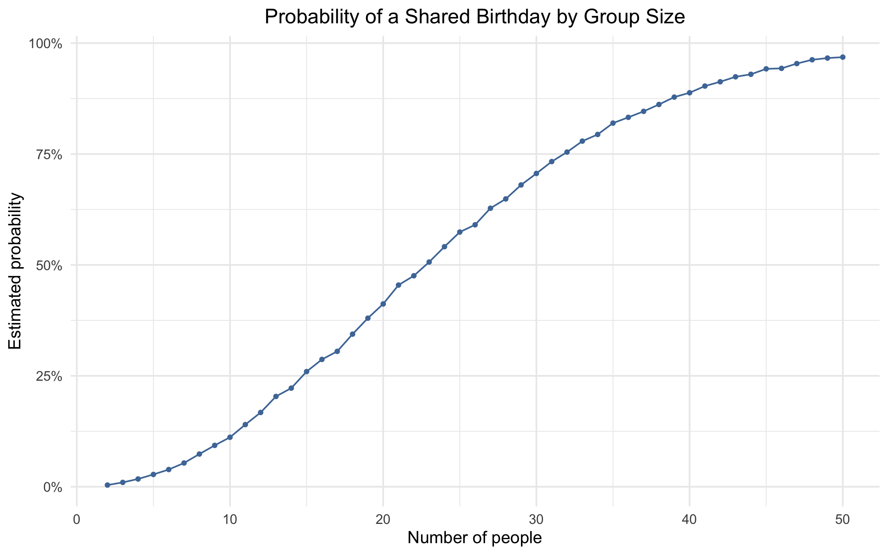
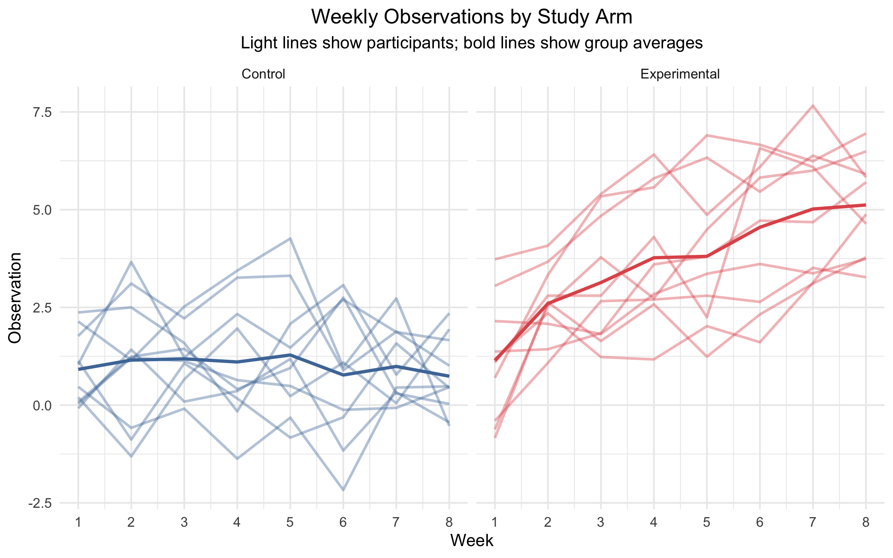
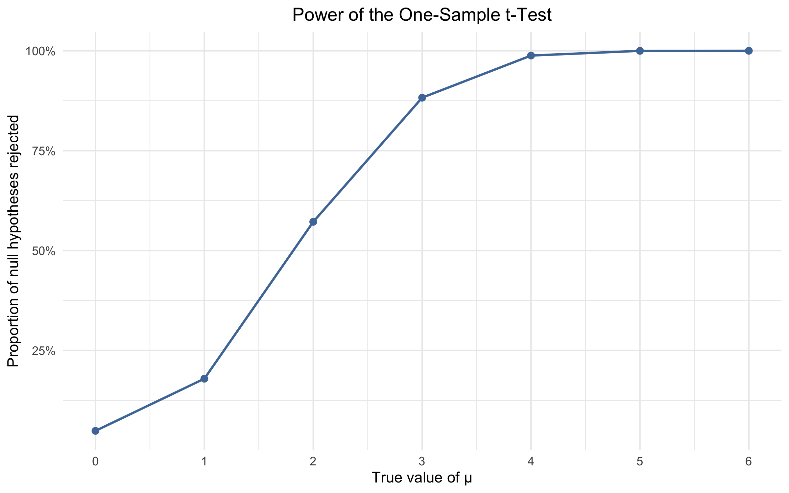
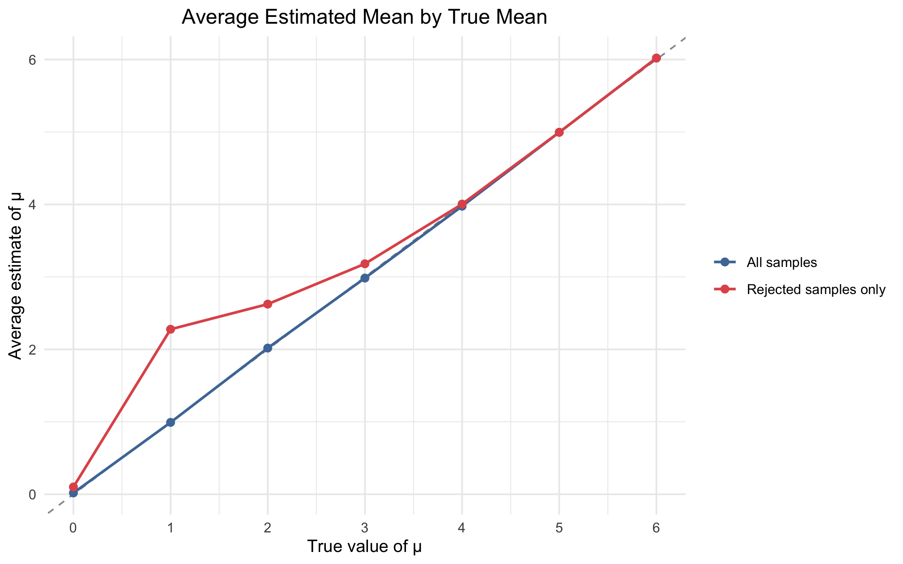

P8105_HW5_sw4257
================

## Problem 1

``` r
birthday_repeated = function(n_room) {
  birthdays = sample(1:365, size = n_room, replace = TRUE)
  repeated_birthdays = length(unique(birthdays)) < n_room
  return(repeated_birthdays)
}

set.seed(4257)

birthday_results_df = expand_grid(number_of_people = 2:50,
                                  iter = 1:10000) |>
  mutate(repeated = map_lgl(number_of_people, birthday_repeated))

birthday_results = birthday_results_df |>
  group_by(number_of_people) |>
  summarize(prob_of_repeat = mean(repeated), .groups = "drop")

ggplot(birthday_results,
       aes(x = number_of_people, y = prob_of_repeat)) +
  geom_line(color = "#4E79A7", linewidth = 0.5) +
  geom_point(color = "#4E79A7", size = 1) +
  scale_y_continuous(labels = scales::label_percent()) +
  labs(title = "Probability of a Shared Birthday by Group Size",
       x = "Number of people",
       y = "Estimated probability") +
  theme_minimal() +
  theme(plot.title = element_text(hjust = 0.5))
```



The estimated probability of at least two people sharing a birthday
increases with group size.

It first reaches 50% at 23 people. For a group of 50, the estimated
probability is 96.8%.

## Problem 2

``` r
subject_files = tibble(
  file = list.files(path = "data",
                    pattern = "\\.csv$",
                    full.names = TRUE)) |>
  mutate(subject_data = map(file, \(x) read_csv(x, show_col_types = FALSE)))

longitudinal_df = subject_files |>
  mutate(file_name = basename(file),
         arm = if_else(str_starts(file_name, "con_"), "Control", "Experimental"),
         subject_id = str_extract(file_name, "[0-9]{2}")) |>
  select(subject_id, arm, subject_data) |>
  unnest(subject_data) |>
  pivot_longer(cols = starts_with("week"),
               names_to = "week",
               values_to = "observation") |>
  mutate(week = parse_number(week),
         arm = factor(arm, levels = c("Control", "Experimental")))
```

``` r
ggplot(longitudinal_df, 
       aes(x = week, 
           y = observation, 
           group = interaction(arm, subject_id), 
           color = arm)) +
  geom_line(alpha = 0.4, linewidth = 0.8) +
  stat_summary(aes(group = arm),
               fun = mean,
               geom = "line",
               linewidth = 1) +
  facet_wrap(~arm, nrow = 1) +
  scale_color_manual(values = c("Control" = "#4E79A7", "Experimental" = "#E15759")) +
  scale_x_continuous(breaks = 1:8) +
  labs(title = "Weekly Observations by Study Arm",
       subtitle = "Light lines show participants; bold lines show group averages",
       x = "Week",
       y = "Observation") +
  theme_minimal() +
  theme(plot.title = element_text(hjust = 0.5),
         plot.subtitle = element_text(hjust = 0.5),
        legend.position = "none")
```


The experimental group’s average observation increased over the eight
weeks, while the control group’s average remained relatively stable.
Individual participants varied within both groups, but the upward trend
was much clearer in the experimental group.

## Problem 3

``` r
simulate_t_test = function(true_mu) {
  sample_values = rnorm(n = 30, mean = true_mu, sd = 5)
  broom::tidy(t.test(sample_values, mu = 0)) |>
    select(estimate, p.value)
}

set.seed(4257)

simulation_results = expand_grid(true_mu = 0:6,
                                 iter = 1:5000) |>
  mutate(test_result = map(true_mu, simulate_t_test)) |>
  unnest(test_result) |>
  mutate(rejected = p.value < 0.05)

simulation_summary = simulation_results |>
  group_by(true_mu) |>
  summarize(power = mean(rejected),
            average_estimate = mean(estimate),
            average_estimate_rejected = mean(estimate[rejected]),
            .groups = "drop")
```

``` r
ggplot(simulation_summary, aes(x = true_mu, y = power)) +
  geom_line(color = "#4E79A7", linewidth = 0.8) +
  geom_point(color = "#4E79A7", size = 2) +
  scale_x_continuous(breaks = 0:6) +
  scale_y_continuous(labels = scales::label_percent()) +
  labs(title = "Power of the One-Sample t-Test",
       x = "True value of μ",
       y = "Proportion of null hypotheses rejected") +
  theme_minimal() +
  theme(plot.title = element_text(hjust = 0.5))
```



The proportion of tests rejecting the null increases as the true mean
moves farther from zero, showing that power increases with effect size.
When the true mean is zero, about 5% of tests reject the null,
consistent with the chosen significance level. Rejection is nearly
certain for true means of 4 or greater.

``` r
simulation_summary |> 
  select(true_mu, average_estimate, average_estimate_rejected) |>
  pivot_longer(cols = c(average_estimate, average_estimate_rejected),
               names_to = "sample_group",
               values_to = "mean_estimate") |>
  mutate(sample_group = 
           recode(sample_group,
                  average_estimate = "All samples",
                  average_estimate_rejected = "Rejected samples only")) |>
  ggplot(aes(x = true_mu, y = mean_estimate, color = sample_group)) +
  geom_abline(slope = 1, intercept = 0, linetype = "dashed", color = "gray60") +
  geom_line(linewidth = 0.8) +
  geom_point(size = 2) +
  scale_x_continuous(breaks = 0:6) +
  scale_color_manual(values = c("All samples" = "#4E79A7",
                                "Rejected samples only" = "#E15759")) +
  labs(title = "Average Estimated Mean by True Mean",
       x = "True value of μ",
       y = "Average estimate of μ",
       color = NULL) +
  theme_minimal() +
  theme(plot.title = element_text(hjust = 0.5))
```



Across all samples, the average estimate is close to the true value of
μ. When μ is small and positive, the average estimate among tests that
reject the null is higher than the true value because samples with
unusually large estimates are more likely to be significant. As power
increases, this difference becomes smaller. At μ = 0, significant
positive and negative estimates approximately cancel when averaged.
